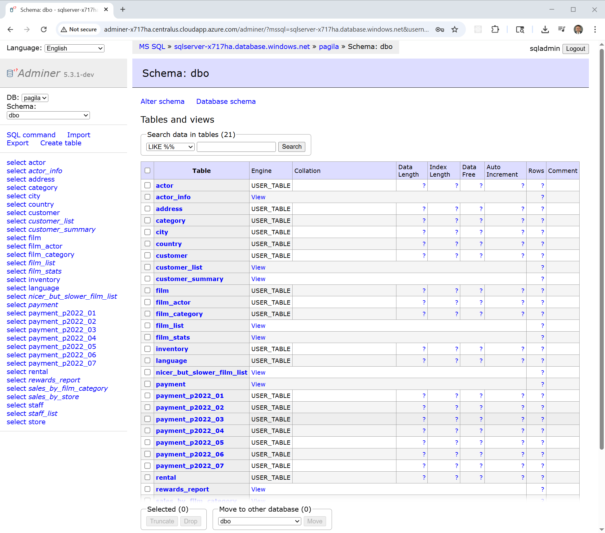
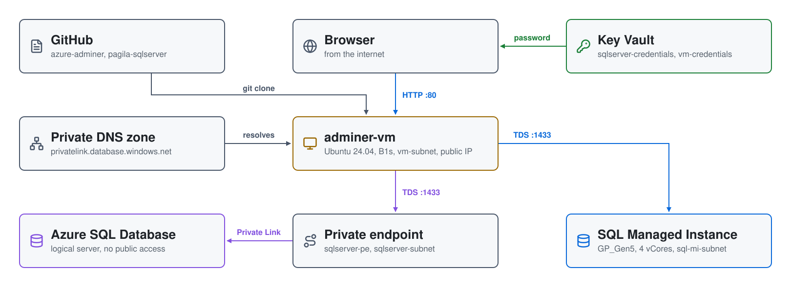

# SQL Server on Azure: Azure SQL Database and SQL Managed Instance with Adminer

Azure's two managed SQL Server options, built side by side with Terraform and
loaded with the same data. An **Azure SQL Database** logical server sits
behind a private endpoint, and a **SQL Managed Instance** runs inside its own
delegated subnet. Neither has a public endpoint; an **Adminer** VM with a
public IP gives you a browser client for both, and both are loaded with a
SQL Server port of [Pagila](https://github.com/mamonaco1973/pagila-sqlserver).



| Piece | Where | Role |
|---|---|---|
| **Azure SQL Database** | private endpoint in `sqlserver-subnet` | logical server `sqlserver-<suffix>`, TLS 1.2, public network access disabled; the `pagila` database is created by the load script |
| **Private endpoint + DNS** | `sqlserver-subnet`, linked to `sqlserver-vnet` | `sqlserver-pe`, and `privatelink.database.windows.net` with an A record for the server |
| **SQL Managed Instance** | `sql-mi-subnet` (delegated) | `sqlmi-<suffix>`, General Purpose `GP_Gen5`, 4 vCores, 64 GB, license included, TLS 1.2, no public data endpoint |
| **adminer-vm** | `vm-subnet`, public IP | Ubuntu 24.04, `Standard_B1s`; loads Pagila into both engines, then serves Adminer |
| **Key Vault** | `sqlserver-rg` | `creds-kv-<suffix>`: `sqlserver-credentials` (admin for both engines) and `vm-credentials` (VM login) |

## Architecture

<picture>
  <source media="(prefers-color-scheme: dark)" srcset="architecture-dark.svg">
  
</picture>

Regenerate with `python3 make_diagram.py`.

- **`01-sqlserver/`** is the whole stack: the resource group
  (`sqlserver-rg`), the VNet (`sqlserver-vnet`, 10.0.0.0/23) with
  `sqlserver-subnet` (10.0.0.0/25), `vm-subnet` (10.0.0.128/25) and the
  delegated `sql-mi-subnet` (10.0.1.0/24) with its NSG and route table, the
  logical server and its private endpoint and DNS, the Managed Instance, the
  Key Vault and passwords, and the Adminer VM.

## How the two engines differ

| | Azure SQL Database | SQL Managed Instance |
|---|---|---|
| What you get | a logical server; databases are created on it individually | a full SQL Server instance |
| Private access | private endpoint in a normal subnet, plus a private DNS zone | injected into its own delegated subnet |
| Instance features | no SQL Agent, limited cross-database queries | SQL Agent, cross-database queries, CLR and other instance-level features |
| Cost and build time | small and quick | the largest cost and the longest step in this lab |

## How it boots

1. Terraform builds the network, the Key Vault, both engines and the VM,
   generating a 24-character password for the `sqladmin` login on both
   engines and the `sysadmin` VM login. The VM waits for both engines.
2. The VM installs Microsoft's `mssql-tools`, clones
   [`pagila-sqlserver`](https://github.com/mamonaco1973/pagila-sqlserver), and
   runs its four scripts with `sqlcmd` against each engine: create the
   `pagila` database, then the tables, the data, and the views, functions and
   indexes. The logical server's steps log to `/tmp/1.*` to `/tmp/4.*`, the
   Managed Instance's to `/tmp/5.*` to `/tmp/8.*` (`.log` and `.error`).
3. It installs Apache, PHP and the `sqlsrv` / `pdo_sqlsrv` drivers, clones
   the [`azure-adminer`](https://github.com/mamonaco1973/azure-adminer) fork
   of Adminer into `/var/www/html`, and redirects `/` to `/adminer`.

## Network security

```
internet ─80, 22─▶ adminer-vm ─1433─▶ private endpoint ─▶ Azure SQL Database
                              ─1433─▶ SQL Managed Instance (sql-mi-subnet)
```

| NSG | Subnet | Allows |
|---|---|---|
| `vm-nsg` | `vm-subnet` | 80 and 22 from anywhere |
| `sqlserver-nsg` | `sqlserver-subnet` | 1433 from anywhere |
| `sql-mi-nsg` | `sql-mi-subnet` | 1433 from anywhere, everything from `AzureLoadBalancer`, all outbound |

Neither engine has a public endpoint, so the 1433 rules only matter inside the
VNet.

## Prerequisites

* [An Azure Account](https://portal.azure.com/)
* [Install AZ CLI](https://learn.microsoft.com/en-us/cli/azure/install-azure-cli)
* [Install Terraform](https://developer.hashicorp.com/terraform/install)
* [Install jq](https://jqlang.github.io/jq/download/)

`check_env.sh` expects a service principal in `ARM_CLIENT_ID`,
`ARM_CLIENT_SECRET`, `ARM_SUBSCRIPTION_ID` and `ARM_TENANT_ID`. If this is
your first time watching our content, we recommend starting with this video:
[Azure + Terraform: Easy Setup](https://youtu.be/j4aRjgH5H8Q).

## Deploy

```bash
git clone https://github.com/mamonaco1973/azure-sqlserver.git
cd azure-sqlserver
./apply.sh       # one phase: VNet, Key Vault, both engines, Adminer VM
```

Everything deploys to Central US. The Managed Instance is by far the slowest
resource to create, so most of the run is spent waiting on it. `apply.sh`
ends by running `validate.sh`, which waits for Adminer to answer (up to 15
minutes) and prints:

```
======================================================================
BUILD VALIDATION COMPLETE
======================================================================
Adminer URL:
  http://adminer-a1b2c3.centralus.cloudapp.azure.com

Azure SQL Server FQDN:
  sqlserver-a1b2c3.database.windows.net

Azure SQL Managed Instance FQDN:
  sqlmi-a1b2c3.0123456789ab.database.windows.net
======================================================================
```

## Try it

1. Get the password from Key Vault:

   ```bash
   vault=$(az keyvault list -g sqlserver-rg --query "[0].name" -o tsv)
   az keyvault secret show --vault-name "$vault" --name sqlserver-credentials \
     --query value -o tsv | jq -r .password
   ```

2. Open the Adminer URL and sign in with System **MS SQL**, one engine's FQDN
   as Server, user `sqladmin`, that password, and database `pagila`. Log out
   and sign in with the other FQDN to switch engines.
3. Run the same queries on both from **SQL command**:

   ```sql
   SELECT TOP 100
       f.title AS film_title,
       a.first_name + ' ' + a.last_name AS actor_name
   FROM film f
   JOIN film_actor fa ON f.film_id = fa.film_id
   JOIN actor a ON fa.actor_id = a.actor_id
   ORDER BY f.title, actor_name;
   ```

   ```sql
   SELECT TOP 100
       f.title,
       STRING_AGG(a.first_name + ' ' + a.last_name, ', ') AS actor_names
   FROM film f
   JOIN film_actor fa ON f.film_id = fa.film_id
   JOIN actor a ON fa.actor_id = a.actor_id
   GROUP BY f.title
   ORDER BY f.title;
   ```

## Troubleshooting

| Symptom | Fix |
|---|---|
| `validate.sh` keeps retrying | The VM is still installing; the PHP drivers build from source with `pecl`. SSH in as `sysadmin` (password in `vm-credentials`) and `sudo tail /var/log/cloud-init-output.log`. |
| `pagila` is missing or empty on one engine | Read that engine's `/tmp/*.error` files on the VM (`1`–`4` for the logical server, `5`–`8` for the Managed Instance). |
| Adminer can't reach the logical server | Its name must resolve to the private endpoint: `nslookup sqlserver-<suffix>.database.windows.net` on the VM should return a 10.0.0.x address. |
| `apply.sh` runs for a long time | The Managed Instance is still being created; leave it running. |

## Teardown

```bash
./destroy.sh     # destroys the Managed Instance first, then everything else
```

## Notes

- **Lab only.** Adminer is open to the internet over plain HTTP, SSH accepts
  password logins from anywhere, and the admin password is in the VM's custom
  data. Restrict `vm-nsg` and add TLS for anything more.
- The Managed Instance (General Purpose, 4 vCores, license included) is the
  largest cost in this lab: run `./destroy.sh` when you finish.
